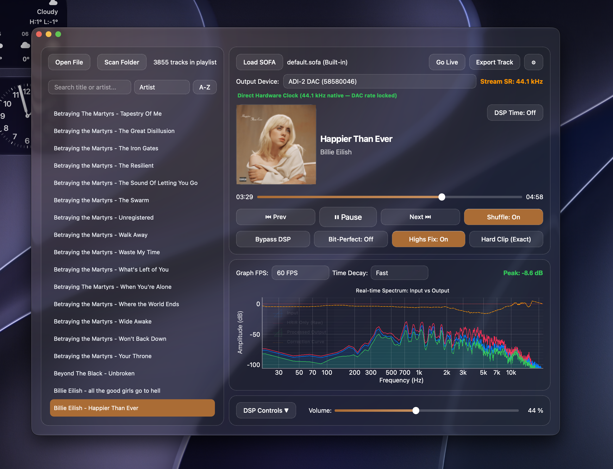
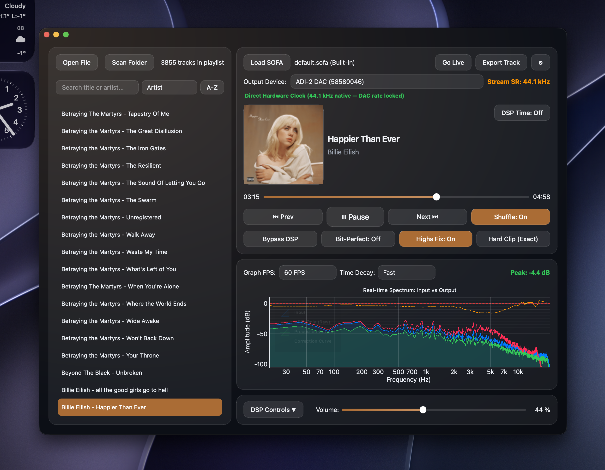
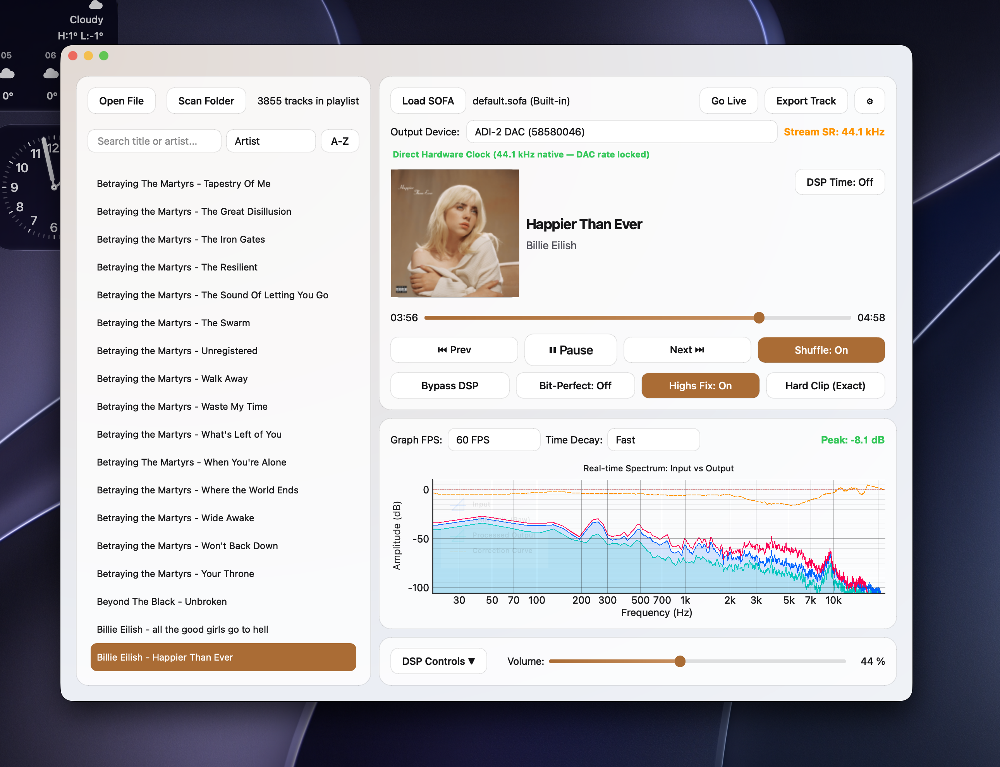

 VIBE CODED 🖤

# REXA — Reflectionless Engine for X-dimensional Audio

A zero-echo, real-time **HRTF (Head-Related Transfer Function)** binaural desktop audio player powered by a native **Rust** DSP backend (`hrtf_core`) and a **Python (PySide6)** interface.

| Liquid Glass |
| :---: |
|  |

| Classic (Dark) | Light |
| :---: | :---: |
|  |  |

## Overview

- **Anechoic Engine (`hrtf_core`):** Rust-based 4-channel partitioned FFT convolution and biquad shelving.
- **Driver-Free System Audio (`Go Live`):** User-space macOS CoreAudio Process Tap (`macos_tap/huq_tap.m`) with automatic native sample-rate locking and live adaptive `Tonal Match`.
- **Audiophile Safety & Precision:** True-peak `-0.5 dBFS` auto-headroom limiter with live `LIM -X.X dB` gain-reduction readout, `Float (32-bit Raw)` output mode, and RME-style 2.0s Left-Click / Instant Right-Click `Bit-Perfect` unity pass-through.
- **Python Desktop UI (`player_ui`):** Fast library scanning, `Open File`, drag-and-drop, global keyboard shortcuts, hold-to-cycle letter navigation, SOFA parsing, and real-time spectrum plotting.
- **Adaptive Hardware Performance:** Includes hardware benchmarking and a `CPU: Full Quality / Low-End` toggle.
- **Format Support:** Decodes FLAC, WAV, MP3, M4A, OGG, and Opus via FFmpeg.

## Prebuilt Releases

For prebuilt Windows (`REXA-Windows.zip`) and macOS Apple Silicon (`REXA-macOS-AppleSilicon.dmg`) binaries, visit the project repository Releases page.

## Status & Platform Focus

- **Desktop (Windows & macOS Apple Silicon):** Active primary targets with full feature parity and prebuilt release binaries.
- **Android (`android_app` / `android_core`):** Early experimental prototype — currently paused and not yet in a usable state for daily listening.

## User Interface & Theming

* **Four-Theme Engine (`player_ui/liquid_glass.py`):**
  * **Classic (Dark):** Deep slate radial ambient wash (`20%` default Ambient Glow) with subtle translucent cards.
  * **Light:** Clean daylight surface (`30%` default Ambient Glow) with perceptual HLS-balanced album accents and high-contrast spectrum curves.
  * **Glass (Liquid Glass):** Native macOS 26 `NSGlassEffectView` / `NSVisualEffectView` refraction via `pyqt_liquidglass` (`100%` default Ambient Glow, `10%` Glass Border Rim) with a Windows 10/11 DWM Acrylic fallback (`apply_windows_glass`).
  * **Glass 2.0:** Native glass with only two **Glass Stage** options — **Dark** (`DarkAqua` + darker native tint/scrim for panel contrast over bright wallpapers) and **Light** (`Aqua` + white tint/scrim) — soft bokeh-like backdrop diffusion, and experimental per-stage tuning. Native glass is applied to the window **and** individual cards, so panels show real material instead of just a QSS tint. Dark `Native Tint` is capped at `52`. The old material modifier selector was removed. Ambient Glow has a stronger ceiling in both glass themes. macOS has no public blur-radius API; the tuning sliders are best-effort native/backdrop values. The internal session/QSS key stays `macos27_glass`; only the visible label changed. Switching themes now clears stale native glass views and event filters, so repeated changes do not accumulate blur layers or slow the UI.
  * Ambient lava stays dynamic with cached blob sprites composited into one small frame: `30 FPS` idle and a lighter `15 FPS` during playback. It no longer freezes on play or spends a full-window Gaussian/dither paint loop that made Classic slower than Glass 2.0.
* **Dedicated Settings Window (`SettingsDialog` via `⚙`):**
  * Houses **Theme** (`Classic` / `Light` / `Glass` / `Glass 2.0`), per-theme **Ambient Glow**, **Glass Stage** (`Dark` / `Light` for Glass 2.0), **Glass Border Rim**, advanced **Native Tint / Panel Scrim / Native Style** controls, and **Low-End CPU Mode**. Panel Scrim runs from 50–100% only — 50% leaves panels fully transparent and the rest of the track ramps up to a full scrim over the native glass. Glass 2.0-only controls (Stage, Native Tint, Panel Scrim, Native Style, Reset Stage Tuning) are greyed out in Classic, Light, and the original Glass; Ambient Glow and Glass Border Rim stay active where they apply. On the white Glass 2.0 stage, muted/secondary text and disabled labels use solid dark grey instead of translucent grey so tips and status text stay readable. Library rows, custom scope/peak widgets, and spectrum axes/labels/legend also follow the surface: dark text on bright themes/stages and bright text on dark ones.
  * Full Quality starts at a sustainable **60 FPS** graph target (precise 16 ms timer); `120 FPS` is an opt-in stress target. The live readout shows achieved/target FPS in both Settings and the spectrum card. If a target is not sustained, the tooltip lists quick fixes: lower Graph FPS, disable Spectrum Gradient Fill, or enable Low-End CPU Mode.
  * Sliders are `ResetSlider` instances—double-click any slider to snap back to that stage's stock default. Backdrop downsample is fixed at `0.50` (eased to `0.33` only in Low-End CPU Mode), so its slider was removed. Double-click **Glass Stage:** to sync `Dark` / `Light` from macOS/Windows public appearance signals. Stage appearance and per-stage tuning overrides persist in `~/.hrtf_audio_player/session.json`.
  * Styled with a diagonal bottom-right (`10%` up) to top-left ambient gradient (`QFrame#settingsRoot`) and persisted to `~/.hrtf_audio_player/session.json`. The dialog is capped to the available screen height and scrolls its contents on short displays.
* **Scrollable Player Layout:** The main player uses a transparent scroll area that keeps the stock proportions and hidden scrollbar until needed. The default window is `1100x880`; the cover/top controls stay at their original `820px` proportions and only the spectrum graph gets taller so the helper tip is fully visible. When you maximize or enter fullscreen, the library grows with the extra height instead of staying short at the top-left. Opening DSP controls (or Stereo scope) adds only that panel's scrollable height and jumps to the bottom instead of shrinking the cover, transport, and spectrum. Scroll back up whenever you want the artwork and other controls.
* **Adaptive Cover Art & Marquee Typography:**
  * Dynamically samples dominant album-art colors (`sample_ambient_rgb`) with smooth `600 ms` `QVariantAnimation` transitions.
  * Long track titles and artist names use `MarqueeLabel` (`QSizePolicy.Ignored`) so cover art never shrinks, scrolling smoothly at 60 FPS on hover.
  * Playlist thumbnails are lazy, cached by file/folder stamp, and loaded with four workers; rows that scroll away cancel queued work so visible covers fill more evenly. Covers decode straight to thumbnail size and share one decoded image per album, so scrolling large libraries stays fast.
* **Cross-Platform Window & Safe Checks:**
  * macOS: Seamless full-bleed titlebar (`apply_seamless_titlebar`) and `WindowDragFilter` (click-drag anywhere, double-click zoom, triple-click fullscreen).
  * Windows: `windows_transparency_enabled()` checks `EnableTransparency` in the registry at startup so VMs or basic GPUs never render a black backing store in `Glass` mode.

## What's New in v0.5.3
- **Glass 2.0 Panel Stability:** Native glass is applied to the main window and individual cards, rebuilt cleanly on every Settings open/close, and cleared on theme changes so panels no longer darken once or accumulate stale blur layers.
- **Seamless Zoom & Fullscreen:** Double-click zoom and fullscreen exit restore the exact window size, graph height, and library height before the next paint; no stretched intermediate frame remains.
- **Sustainable Graph Readout:** Full Quality now targets 60 FPS by default with a live achieved/target FPS badge in Settings and the spectrum card; 120 FPS stays opt-in, and the lava overlay keeps moving at 30 FPS idle / 15 FPS during playback.
- **Cleaner Glass 2.0 UI:** The visible theme label is `Glass 2.0` (internal key unchanged), the cover lens pill stays exclusive to the original `Glass` theme, white-stage text stays readable, and Glass 2.0-only controls are greyed out where they do not apply.
- **Smoother Library Scrolling:** Lazy cover thumbnails are cached and decoded at thumbnail size, with cancelled work for rows that scroll away, so large libraries fill evenly without rescanning tags.
- **Ambient Colors Follow the Current Track:** Background wash, buttons/glow accent, and lava palette switch together to the new cover; no previous-track hue lingers during a fade.

## What's New in v0.5.2
- **One-Click Last.fm Browser Scrobbling:** Passwordless browser OAuth flow with Pano-style dual-threshold delay sliders (*Min Track Length*, *Percentage*, and *Minutes*) and a live scrobble progress bar.
- **Built-In In-App Auto-Updater:** Checks GitHub Releases directly from **Settings** and seamlessly updates & relaunches on both macOS and Windows.
- **Album-Grouped Library & Cover Art Inspector:** `Artist • Album` sorting with `44×44` album cover dividers, disc/track ordering, right-click **Show in Finder / Explorer**, and **Track Properties** with a full-window + `72%` rectangular loupe cover viewer.
